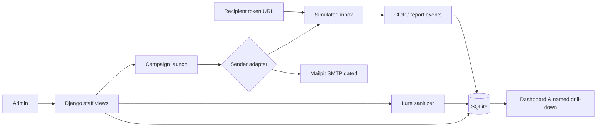

# Hookline

**Hook, line, and awareness.**

Hookline is a self-hosted phishing simulation and security-awareness platform
for small teams. An administrator imports employees, chooses a lure from a
library of fictional templates, records authorization, and launches a campaign.
Each recipient gets a private simulated inbox. Clicking the call to action
records a click and opens a personalized lesson; reporting the message opens a
positive confirmation. Nothing asks for a credential, and no external email is
sent by default.

> **Status:** the application build is complete; the demo content and video
> package are being finalized. See [tickets](docs/tickets.md) for the exact
> state of each step.

## Features

- **Click-only simulations** — no fake login page, no password field, no
  credential capture, no attachments.
- **Fictional lure library** — parameterized HTML with an `nh3` allowlist, live
  preview, principles, red flags, and difficulty levels.
- **Private recipient inbox** — one capability-token URL per recipient, with a
  familiar mail-client layout that works on desktop and mobile.
- **Education and reporting** — reveal banner, outcome, the original email,
  red flags, principle explanations, and a report CTA.
- **Aggregate-first reporting** — named drill-down is a per-campaign opt-in.
  Dashboard KPIs, funnel, department breakdown, timeline, and event log.
- **Safety gates** — authorization record before launch, excluded targets
  skipped, demo-mode gate and allowlist before SMTP, 90-day event retention.
- **Django craft** — models, forms, HTMX partials, staff-only admin views,
  capability tokens, pytest, ruff, and pip-audit in CI.

## Safety

Hookline is a training tool, not a phishing kit.

- It never captures credentials and renders no fake login page.
- It uses fictional brands, people, and `.example` domains only.
- It sends no external email by default; SMTP requires demo mode off and an
  explicit recipient-domain allowlist.
- It stores no IP addresses, user agents, geolocation, or device fingerprints.
- Recipient routes send `no-referrer` and `noindex`, and tokens are redacted
  from application logs.
- Use it only with written authorization from the organization being tested.

Read the [threat model](docs/threat-model.md) and
[security policy](SECURITY.md) before running a real exercise.

## Screenshots and video (TBA)

> **Screenshot:** dashboard with seeded campaign metrics — coming in the demo
> capture pass.

> **Screenshot:** campaign detail with funnel and named recipient table —
> coming in the demo capture pass.

> **Screenshot:** the Northwind Mail simulated inbox — coming in the demo
> capture pass.

> **Screenshot:** personalized education page — coming in the demo capture
> pass.

> **Video:** 3–5 minute recorded walkthrough — coming in the demo capture pass.

The [demo script](docs/DEMO.md) is ready and can be followed today.

## Quickstart

No Docker, Node, or external services are required.

```bash
python3 -m venv .venv
. .venv/bin/activate
pip install -r requirements-dev.txt
python manage.py migrate
python manage.py seed_demo --with-admin
python manage.py runserver
```

Open <http://127.0.0.1:8000/>. The seed command prints an admin password and
three sample inbox links. If you prefer `make`:

```bash
make demo
```

> **Troubleshooting:** a virtualenv stores absolute paths in its generated
> scripts. If you rename or move this folder after creating `.venv`, scripts
> like `pip` will fail with `required file not found`. Rebuild it from the new
> location: `rm -rf .venv && python3 -m venv .venv && . .venv/bin/activate &&
> pip install -r requirements-dev.txt`. Use a plain `. .venv/bin/activate`
> (no `.sh` suffix); the file is named `activate`.

Optional Mailpit path:

```bash
make mailpit
make mailpit-run
```

Then set `EMAIL_BACKEND=django.core.mail.backends.smtp.EmailBackend`,
`DEMO_MODE=0`, and `ALLOWED_RECIPIENT_DOMAINS=northwind.example` in `.env` (see
`.env.example`) before launching a campaign.

## Tests and tooling

```bash
make test        # pytest
make lint        # ruff check + ruff format --check
pip-audit -r requirements.txt
python manage.py check --deploy
```

The GitHub Actions workflow runs lint, format check, tests, and the dependency
audit on every push and pull request.

## Architecture



Apps: `core` (organization, shell, dashboard, settings), `targets` (people,
groups, CSV import), `lures` (templates, sanitizer, preview), `campaigns`
(drafts, authorization, launch, reporting, senders), and `tracking` (inbox,
clicks, reports, education).

Key recipient routes: `/i/<token>/`, `/t/<token>/`, `/t/<token>/report/`, and
`/education/<token>/`.

## Documentation

- [Specification](docs/spec.md)
- [Tickets and status](docs/tickets.md)
- [Agent handoff](AGENTS.md)
- [Glossary](docs/GLOSSARY.md)
- [Threat model](docs/threat-model.md)
- [Security policy](SECURITY.md)
- [Authoring guide](docs/social-engineering.md)
- [Demo script](docs/DEMO.md)
- [Business case](docs/business-case.md)
- [Architecture decisions](docs/adr/)

## License

[MIT](LICENSE), with a responsible-use notice.
